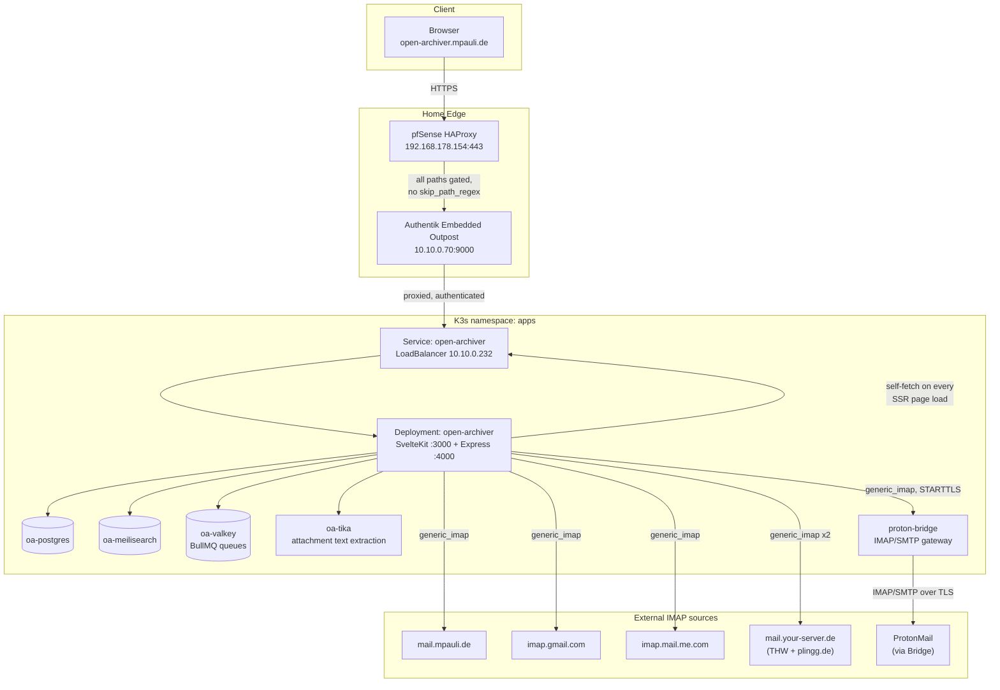
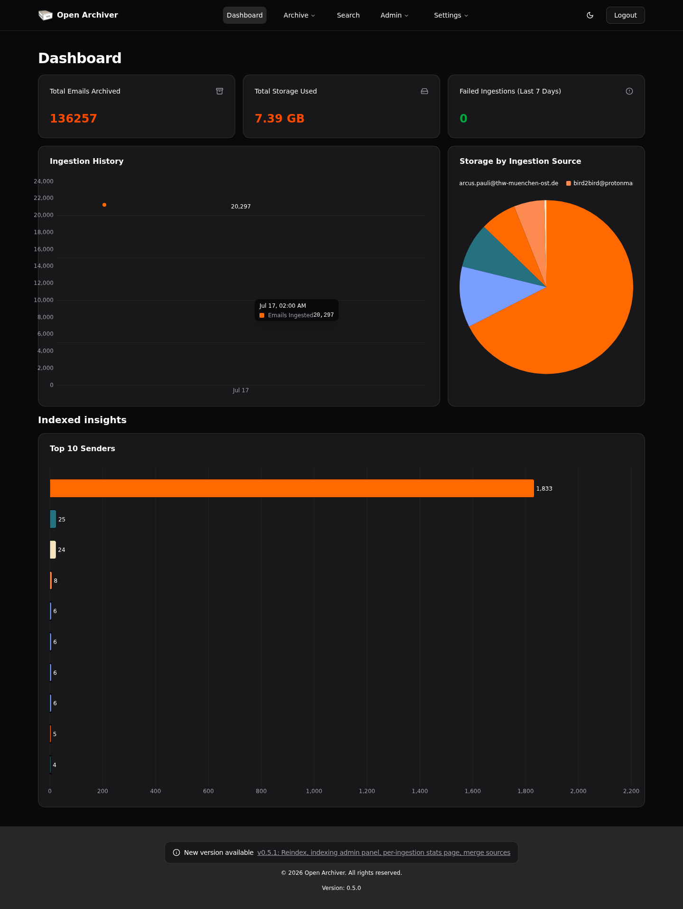
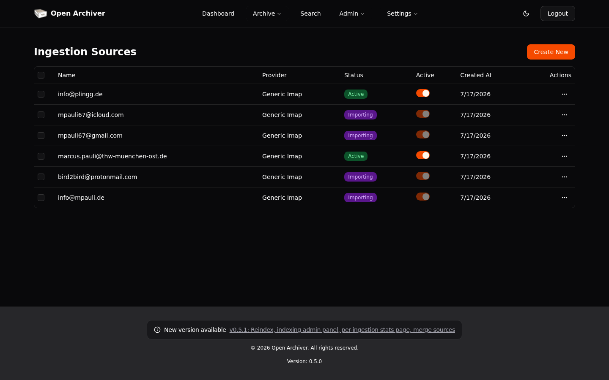
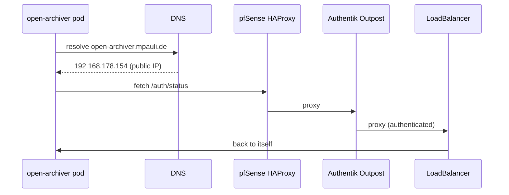

# Open Archiver — mail archiving stack

Self-hosted mail archiver (SvelteKit + Express backend) for 6 IMAP mailboxes,
gated behind Authentik SSO (`open-archiver.mpauli.de`). Full-text search via
Meilisearch, attachment text extraction via Tika, background sync via
BullMQ/Valkey.

## Architecture



The `OA -->|self-fetch| LB` edge is not a mistake — it is a real, unavoidable
call the app makes to itself, and the reason for the `hostAliases` fix below.

## Components

| Component      | Image                                                                                          | Service (ClusterIP)          | Notes                                                    |
|----------------|--------------------------------------------------------------------------------------------------|-------------------------------|-----------------------------------------------------------|
| PostgreSQL 17  | `postgres:17-alpine`                                                                              | `oa-postgres:5432`             | App DB, 5Gi PVC                                            |
| Meilisearch    | `getmeili/meilisearch:v1.15`                                                                       | `oa-meilisearch:7700`          | Full-text search index, 20Gi PVC                           |
| Valkey 8       | `valkey/valkey:8-alpine`                                                                           | `oa-valkey:6379`               | BullMQ broker, no PVC (emptyDir, queues are transient)     |
| Apache Tika    | `apache/tika:3.2.2.0-full`                                                                         | `oa-tika:9998`                 | Attachment text extraction                                 |
| Proton Bridge  | `shenxn/protonmail-bridge:latest`                                                                  | `proton-bridge:1025`/`:1143`   | IMAP/SMTP gateway for the ProtonMail source, 1Gi PVC       |
| Open Archiver  | pinned digest of `logiclabshq/open-archiver` (see below — **do not** switch to `:latest`)          | `open-archiver:3000`/`:4000`   | LoadBalancer `10.10.0.232`, gated by Authentik outpost      |

## Apply

```bash
export KUBECONFIG=/etc/rancher/k3s/k3s.yaml
# first time only — real values never committed, see secrets.example.yaml
kubectl apply -f secrets.yaml
kubectl apply -k /root/Ice-Kubernetes/manifests/apps/openarchiver/
```

Boot order — first time only: postgres/meilisearch/valkey/tika become Ready,
then proton-bridge (needs its one-time interactive login, see below), then
open-archiver last (needs all of the above reachable).

## Mail sources (6, configured in the Web UI — passwords entered by hand, never stored here)

| Account                            | Host                  | Port | Security | Notes                                              |
|-------------------------------------|-----------------------|------|----------|-----------------------------------------------------|
| info@mpauli.de                      | mail.mpauli.de        | 993  | SSL/TLS  | Axigen, self-hosted                                  |
| mpauli67@gmail.com                  | imap.gmail.com        | 993  | SSL/TLS  | needs a Google App Password                          |
| mpauli67@icloud.com                 | imap.mail.me.com      | 993  | SSL/TLS  | needs an Apple app-specific password                 |
| marcus.pauli@thw-muenchen-ost.de    | mail.your-server.de   | 993  | SSL/TLS  | Hetzner Webhosting                                    |
| info@plingg.de                      | mail.your-server.de   | 993  | SSL/TLS  | same Hetzner box as above                             |
| bird2bird@protonmail.com            | `proton-bridge.apps.svc.cluster.local` | 1143 | **STARTTLS + Allow Insecure Certificate** | via the in-cluster Bridge, see below |

`ALL_INCLUSIVE_ARCHIVE=true` in the secret — Junk/Trash are archived too,
not excluded.

## Proton Bridge — one-time interactive login

Community image, no real TTY. Two terminals:

```bash
# Terminal 1 — watch prompts/output
kubectl -n apps logs -f deploy/proton-bridge

# Terminal 2 — send input into the bridge's fake TTY
kubectl -n apps exec -it deploy/proton-bridge -- sh -c 'cat > /protonmail/faketty'
```

In terminal 2, type: `login`, then the ProtonMail email, then the ProtonMail
password, then a 2FA code if prompted. Once logged in, type `info` to print
the Bridge's **own** generated IMAP/SMTP credentials (host will show
`127.0.0.1` — that's from Bridge's own point of view; from inside the
cluster use the Service DNS name instead, see table above). Copy the
username + password shown into the Open Archiver ingestion source form.
Finish with `exit`.

⚠️ Any single write to `/protonmail/faketty` that closes immediately (e.g. a
plain `echo cmd > faketty`) sends EOF to the piped `cat faketty |
protonmail-bridge --cli` and kills the container, forcing a restart. It
self-heals (persisted vault ⇒ automatic re-login, no 2FA needed again), but
avoid triggering it unnecessarily — keep the writer process open for the
duration of the session (e.g. `(printf '...\n'; sleep N) | kubectl exec -i ...`).

### ProtonMail ingestion source form gotchas

- **"Use TLS" toggle** maps to implicit-TLS-vs-STARTTLS, not
  encrypted-vs-plaintext. Bridge's IMAP port (1143) is STARTTLS-only — leave
  "Use TLS" **off**. Turning it on produces
  `SSL routines:tls_get_more_records:packet length too long` (the client
  attempts a direct TLS handshake against a plaintext-first port).
- There is a **second, easy-to-miss checkbox** right next to "Use TLS":
  **Allow Insecure Certificate**. Bridge's cert is self-signed
  (`CN=127.0.0.1`) — without this checked, the app rejects it mid-handshake
  (`Unexpected close` client-side / `Cannot upgrade connection error=EOF` in
  the Bridge log). The app-wide `NODE_TLS_REJECT_UNAUTHORIZED=0` does **not**
  cover this — the IMAP connector explicitly sets
  `rejectUnauthorized: !allowInsecureCert` per-source.

## Screenshots

Dashboard after all 6 sources were added (numbers from the real archive):



Ingestion sources list, mid first-sync:



## Troubleshooting / incident history

### Self-referencing SSR fetch → total pod hang → 504 (17.07.2026)

On every server-rendered page load, the app calls `fetch("${ORIGIN}/auth/status")`
**on itself**. With `ORIGIN=https://open-archiver.mpauli.de` (the public
hostname), that call is *not* short-circuited in-process — it goes all the
way back out:



Under load (a browser opens several parallel requests, each one triggers this
self-check) or any hiccup on that round-trip, these `fetch()` calls pile up
(`UND_ERR_HEADERS_TIMEOUT` in undici) until the single-threaded Node process
is completely wedged — at that point even a direct pod-IP curl from the same
node times out, `kubectl get pods` still shows `1/1 Running` (no probes
existed at the time), and Authentik's own outpost logs show **zero** entries
for the request (it never even reached the app).

**Fix:** `hostAliases` in the Deployment (`10.43.38.127` = the Service's own
ClusterIP → `open-archiver.mpauli.de`). The pod now resolves its own public
hostname straight to itself, in-cluster, bypassing pfSense/Outpost/LB
entirely for this one self-check. External users are unaffected — public DNS
is untouched.

### Broken v0.5.1 migration + image drift

`imagePullPolicy: Always` silently pulled a newer `logiclabshq/open-archiver:latest`
during an unrelated `kubectl rollout restart`. That image's new migration
(`CREATE INDEX idx_merged_into ...`, part of the "merge ingestion sources"
feature) hung forever. **Fix:** pin the Deployment to a known-good image
**digest** + `imagePullPolicy: IfNotPresent` (see `open-archiver.yaml`).
Do not switch back to `:latest`.

### 19.5h-hung Postgres transaction blocking `ingestion_sources`

A side effect of the incident above: the stuck `CREATE INDEX` backend was
never actually terminated when the image was rolled back — it (and 37 more
queries that queued up behind its lock over the following hours) kept
running as `active` in `pg_stat_activity`, silently blocking every
`/dashboard` and `/api/v1/ingestion-sources` call (real symptom: login
works, dashboard/sources hang forever → 504). **Fix:**

```sql
SELECT pid, pg_terminate_backend(pid)
FROM pg_stat_activity
WHERE datname = current_database()
  AND pid <> pg_backend_pid()
  AND now() - query_start > interval '1 minute';
```

**Lesson:** rolling back a broken image does not clean up backend processes
that are already stuck — check `pg_stat_activity` separately after any
migration incident.

### Crash-loop from an overly strict liveness probe

The container reinstalls **all ~631 npm packages from scratch on every
start** (no persisted `node_modules`) — cold start can take well over 30s.
An initial `livenessProbe` with `initialDelaySeconds: 30` killed the pod
mid-install every time, forever. **Fix:** added a `startupProbe`
(`initialDelaySeconds: 20, periodSeconds: 10, failureThreshold: 30` ⇒ ~320s
budget); liveness/readiness only take over once startup succeeds once.

### `JWT_EXPIRES_IN` / `SYNC_FREQUENCY` quote bugs

Both secret values were copied in **with their literal surrounding quotes**
(`"7d"` / `'*/5 * * * *'` — quotes included as actual bytes, not just shell
quoting). `JWT_EXPIRES_IN="7d"` broke the `jose` library's time parser and
failed every single login (`TypeError: Invalid time period format`).
`SYNC_FREQUENCY='*/5 * * * *'` crashed the `sync-scheduler` sub-process on
every start (`cron-parser`: `Invalid characters, got value: '*/5`). **Fix:**
strip the quotes, store the plain value. **Check any other env var copied
from an old `.env` file for the same mistake.**

### Proton-Bridge had no persistence + no working keychain

Originally no PVC (login lost on every restart/OOM — 256Mi limit,
repeatedly OOMKilled) and no initialized `pass`/`gpg` keychain backend
(`Could not load/create vault key`). **Fix:** PVC across `.config`,
`.local/share`, `.cache`, `.gnupg`, `.password-store`; GPG key generated
without passphrase + `pass init`; memory limit 256Mi → 768Mi. Also hit a
`libfido2.so.1` missing-library error after Bridge auto-updated itself
(3.19.0 → 3.25.0) — the lib was copied into the persisted volume
(`extra-libs/`) and `LD_LIBRARY_PATH` set accordingly, so it survives
container restarts.

### Known minor issue, not yet investigated

`oa-tika` occasionally logs `All Tika URLs failed` during attachment text
extraction. Ingestion itself is unaffected (the email is still archived),
only full-text indexing of that attachment's content is skipped. Not
chased down yet — check `oa-tika` resource limits / logs if it becomes a
real search-quality problem.
